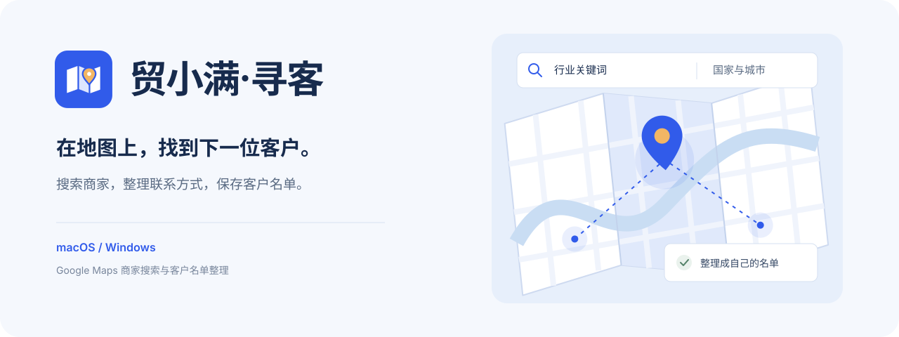
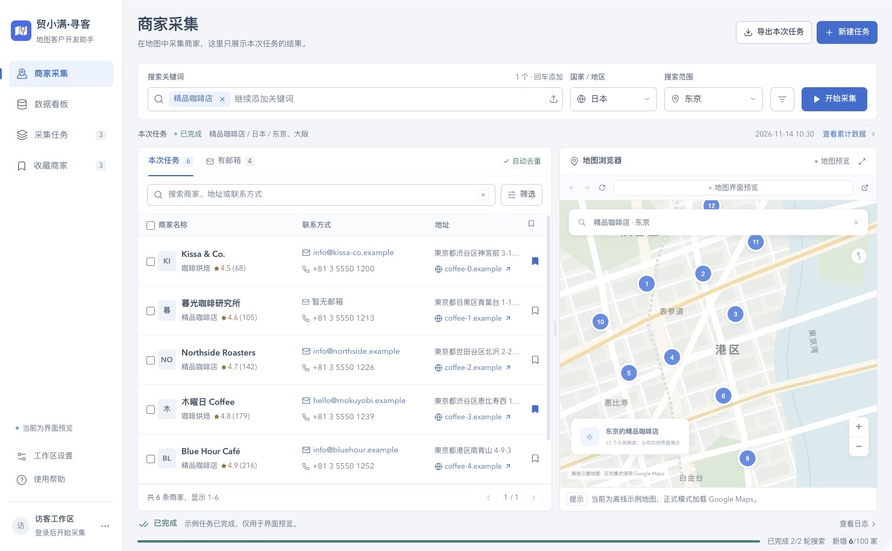
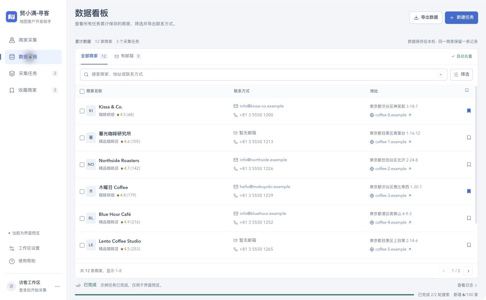

# Maoxiaoman Xunke

**A desktop prospecting assistant for international trade.**

Search Google Maps businesses by keyword and city, review contact details, and keep a local prospect list. The map and your results stay together in one desktop window.

[简体中文](README.md) · [Maoxiaoman website](https://maoxiaoman.cn) · [Releases](https://github.com/maoxiaoman-org/xunke/releases) · [Report an issue](https://github.com/maoxiaoman-org/xunke/issues/new/choose)

_Actual application preview with demonstration businesses, contact details, and map content. Normal use loads Google Maps. The screenshots show the Chinese interface._

## What you can do

- Search multiple cities and industry keywords within a selected country.
- Browse Google Maps and complete manual verification inside the main window.
- Review business phone numbers and websites, and optionally look for publicly listed website emails.
- Deduplicate by Google business identifiers: collect only new businesses or update saved businesses.
- Keep businesses, tasks, and favorites on your computer, with separate views for task results and accumulated data.
- Filter your list and export Excel or CSV files for follow-up.

_Demonstration data; the screenshot does not represent collection volume or coverage._

## Downloads

**v1.2.3 pre-release** is available in [Releases](https://github.com/maoxiaoman-org/xunke/releases/tag/v1.2.3). Choose the installer for your platform and architecture, and check the release notes for checksums and limitations.

| Platform                         | Installer | Download |
| -------------------------------- | --------- | -------- |
| macOS · Apple silicon (M series) | `.dmg`    | [Download for macOS](https://github.com/maoxiaoman-org/xunke/releases/download/v1.2.3/maoxiaoman-xunke-1.2.3-mac-arm64.dmg) |
| Windows · x64                    | `.exe`    | [Download for Windows](https://github.com/maoxiaoman-org/xunke/releases/download/v1.2.3/maoxiaoman-xunke-1.2.3-windows-x64.exe) |

An Intel Mac version and a Linux installer are not currently available. These installers are unsigned; the full collection flow on native Windows x64 hardware has not yet been verified.

A free trial is available. Guests can collect businesses within the device quota; exporting requires email registration and sign-in. Business records and exports use separate quotas; available balances are shown in the app.

## Getting started

1. Add industry keywords and select a country and one or more cities.
2. Create a task, choose whether to collect new businesses or update saved ones, and set a limit.
3. Follow the embedded map. Complete any CAPTCHA yourself, then resume the task.
4. Review and filter the results, export Excel or CSV, and verify the details before contacting businesses.

## Before you start

- **Network:** your computer must be able to access Google Maps. Results depend on the map's actual responses; the task limit does not guarantee that many results.
- **Contact details:** phone numbers, websites, and emails may be unavailable or outdated. Verify them before use.
- **Storage:** businesses, tasks, and favorites stay on your computer. The account service manages sign-in and quotas; it does not automatically sync your business list. Export important records before changing computers or uninstalling.
- **Web workspace:** [Maoxiaoman](https://maoxiaoman.cn) creates trade documents such as quotations, PI, CI, and packing lists. It is a separate product; Xunke lists do not automatically sync to it.
- **Updates:** automatic download and installation of updates are not implemented yet. Check Releases for future installers and version notes.

## Feedback

Use [Issues](https://github.com/maoxiaoman-org/xunke/issues/new/choose) to report a bug or suggest an improvement. Include your operating system, app version, reproduction steps, and expected behavior. You can also use the [website feedback form](https://maoxiaoman.cn/#/feedback) without a GitHub account.

Issues and attachments are public. Remove customer details, email verification codes, passwords, and other private information before posting.

## About this repository

This repository hosts public product information, releases, and feedback for **Maoxiaoman Xunke**. It does not contain application source code or grant an open-source license to the application code.

Google Maps is a third-party service. Xunke is not an official Google product.
