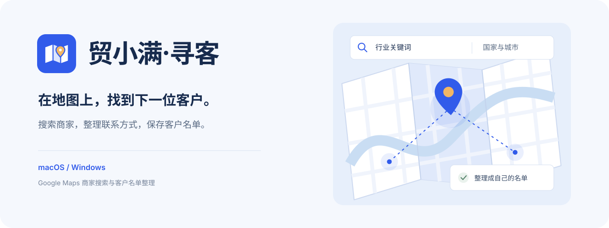
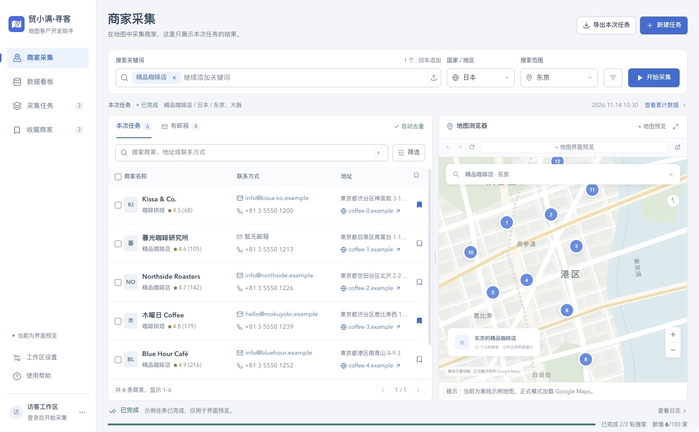
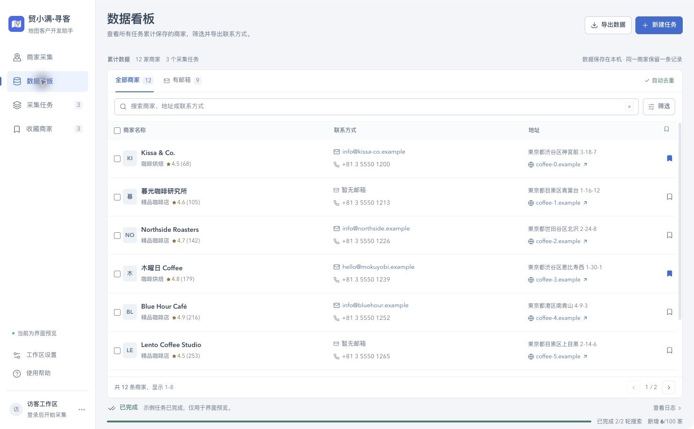

# 贸小满·寻客

**给外贸业务员的地图客户开发助手。**

按关键词和城市搜索 Google Maps 商家，在一个桌面窗口里查看地图、整理联系方式，把找到的商家保存成可继续跟进的客户名单。

[English](README.en.md) · [贸小满官网](https://maoxiaoman.cn) · [下载与版本](https://github.com/maoxiaoman-org/xunke/releases) · [反馈问题](https://github.com/maoxiaoman-org/xunke/issues/new/choose)

_软件实际界面预览；图中的商家、联系方式和地图为演示数据，正式使用时加载真实 Google Maps。_

## 可以用寻客做什么

| 你想做的事     | 寻客提供的能力                                             |
| -------------- | ---------------------------------------------------------- |
| 按市场寻找商家 | 选择国家与多个城市，组合多个行业关键词依次搜索             |
| 少切换几个窗口 | Google Maps 嵌入软件主窗口，直接查看地图和处理人工验证     |
| 整理联系方式   | 查看商家电话、官网，并查找网站公开邮箱与社交渠道               |
| 减少重复整理   | 按 Google 商家标识去重，选择“仅采集新商家”或“更新已有商家” |
| 保留开发记录   | 商家、任务和收藏保存在当前电脑，区分本次任务与累计数据     |
| 导出后继续跟进 | 筛选名单，导出 Excel 或 CSV；可导出指定任务或累计商家      |

### 本次任务清楚，累计名单也清楚

采集页查看本次任务的结果，数据看板查看历次任务累计保存的商家。重复搜索同一市场时，可以继续寻找新商家，也可以更新已保存的资料。

_演示数据，不代表搜索覆盖率或实际采集数量。_

## 下载

**v1.2.5 测试版**已在 [Releases](https://github.com/maoxiaoman-org/xunke/releases/tag/v1.2.5) 发布。请选择与系统和架构对应的安装包，并查看版本说明中的校验值与已知限制。

| 平台                         | 安装格式 | 下载 |
| ---------------------------- | -------- | ---- |
| macOS · Apple 芯片（M 系列） | `.dmg`   | [下载 macOS 安装包](https://github.com/maoxiaoman-org/xunke/releases/download/v1.2.5/maoxiaoman-xunke-1.2.5-mac-arm64.dmg) |
| Windows · x64                | `.exe`   | [下载 Windows 安装包](https://github.com/maoxiaoman-org/xunke/releases/download/v1.2.5/maoxiaoman-xunke-1.2.5-windows-x64.exe) |

v1.2.5 修复 Windows 窗口重复显示两排标题栏和窗口按钮的问题。安装包继续复用 Electron 浏览器，Mac 和 Windows 体积约为 v1.2.3 的一半。

Intel 芯片的 Mac 暂无可用版本。当前也不提供 Linux 安装包。安装包尚未签名或公证；Windows x64 的完整采集流程仍待在原生设备验证。

前期提供免费试用。游客可按设备额度采集商家；导出需要邮箱注册并登录。采集商家条数与导出次数分别计算，具体额度以客户端账号面板为准。

## 从搜索到客户名单

1. **选市场**：添加行业关键词，选择国家和一个或多个城市。
2. **建任务**：选择仅采集新商家或更新已有商家，设置数量上限与邮箱查找选项。
3. **看过程**：在内嵌地图查看搜索，遇到验证码时手动完成验证后继续。
4. **整理与导出**：筛选本次任务或累计名单，导出 Excel / CSV，再核实和跟进商家。

## 常见问题

### 与贸小满网页工作台有什么区别？

寻客是需要下载安装的地图客户开发工具；[贸小满网页工作台](https://maoxiaoman.cn)用于制作报价单、PI、CI 和装箱单。两者目前独立使用，寻客的商家名单不会自动同步到网页工作台。

### 需要能够访问 Google Maps 吗？

需要。软件依赖当前电脑的网络访问 Google Maps。地图返回结果、搜索范围及商家公开资料会影响采集结果，设置的数量上限不保证一定能达到。

### 电话、官网和邮箱一定能找到吗？

不能保证。联系方式取决于商家公开信息和网站可访问情况，部分商家没有官网或公开邮箱。联系前请核实信息，并遵守适用的平台条款与当地规则。

### 数据会保存在云端吗？

商家、任务与收藏保存在当前电脑；账号服务用于登录与额度管理，不自动同步商家名单。更换电脑或卸载前，请先导出需要保留的数据。

### 支持自动更新吗？

目前还没有客户端自动下载安装更新功能。新版本开放后，请查看 Releases 中的版本说明与对应系统安装包。

## 反馈与交流

欢迎通过 [Issues](https://github.com/maoxiaoman-org/xunke/issues/new/choose) 报告问题或提出建议。请提供系统、软件版本、操作步骤及预期结果，帮助定位问题。没有 GitHub 账号，也可以通过[贸小满网站反馈](https://maoxiaoman.cn/#/feedback)联系。

Issue 和附件对所有人可见，请先隐藏真实客户资料、邮箱验证码、密码等信息。

## 关于本仓库

这是 **贸小满·寻客的公开产品介绍、版本发布与反馈仓库**，不包含应用源代码，也不授予应用代码的开源许可。

Google Maps 是第三方地图服务，寻客并非 Google 官方产品。
